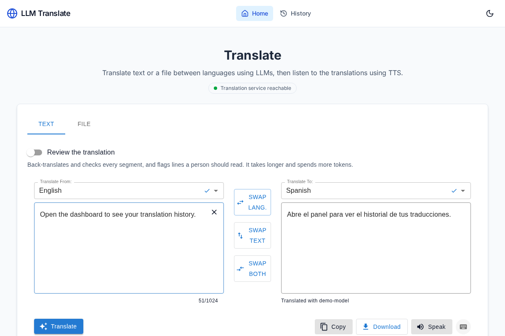
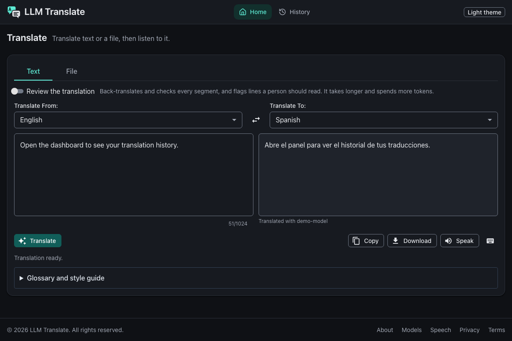
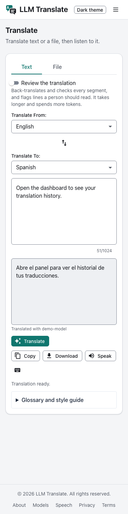
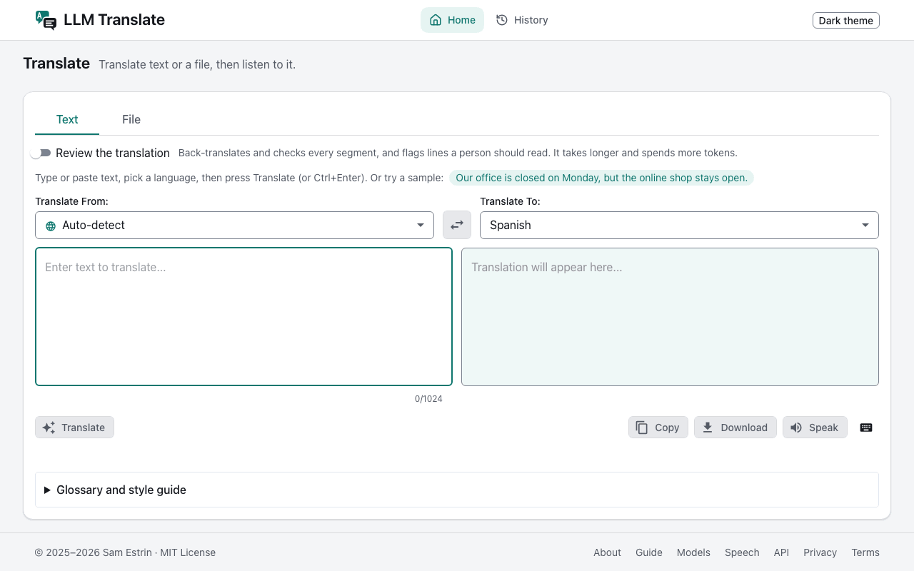

# llm-translate

<p align="center">
  <picture>
    <source media="(prefers-color-scheme: dark)" srcset="docs/images/logo-dark.svg">
    
  </picture>
</p>

A self-hosted translation app and HTTP API for anyone who wants model-quality translations of text and whole files (JSON, YAML, PO, Markdown, HTML and SRT) through any OpenAI-compatible endpoint, with placeholders and file structure kept, a glossary and style guide, and an optional review pass that flags the segments a person should read.

<p>
  <a href="https://github.com/samestrin/llm-translate/actions/workflows/ci.yml"></a>
  <a href="https://github.com/samestrin/llm-translate/releases/latest"></a>
  <a href="LICENSE"></a>
</p>

## Demo







*The screenshots (light, dark and phone width) are captured by `npm run capture:readme` in `frontend/` (`frontend/scripts/screenshot.mjs`: Playwright against the real backend, whose model endpoint is a fake OpenAI server, so no key is shown). The GIF below is a real session recorded by `npm run capture:live` against a running instance with live models (`frontend/e2e/live/demo.spec.js`).*



## Why

- Translating app strings and documents by hand, or one string at a time, breaks placeholders and structure. Here a whole JSON, YAML, PO, Markdown, HTML or SRT file goes in and comes back with its keys, placeholders, code and timings intact; only the text is translated.
- Product terms drift between translations. A glossary (including terms never to translate) and a style guide (tone, formality, audience) go with every request, and the reply lists every glossary term the translation missed.
- A model translation can be wrong in ways nobody notices. The optional review pass back-translates, reviews and revises each segment, then flags the ones a person should read, with the reason and the tokens it cost.
- You may not want one vendor. The backend talks to any OpenAI-compatible endpoint (OpenAI, Groq, OpenRouter, a local Ollama), set with three environment variables.
- Translations should be heard as well as read. The page reads a translation aloud through the configured speech model, with a voice per language on a Kokoro model.

## Install

Docker Compose is the most common way to run both services. You need Git and Docker with Docker Compose.

```bash
git clone https://github.com/samestrin/llm-translate.git && cd llm-translate
docker compose up --build
```

From source you need Python 3.9+ for the backend and Node.js 18 or later for the frontend; [docs/development.md](docs/development.md) has the steps, and the [backend README](backend/README.md) and [frontend README](frontend/README.md) cover each service.

Compose reads `backend/.env` when it exists, and `LLM_BASE_URL`, `LLM_API_KEY` and `LLM_TRANSLATE_MODEL` from the shell or a root `.env` (these win). Neither file is required. Both ports listen on `127.0.0.1` only. For hot reload, add the dev override: `docker compose -f docker-compose.yml -f docker-compose.dev.yml up --build`. To run in the background add `-d`, and to stop the services run `docker compose down`.

## Quick start

```bash
git clone https://github.com/samestrin/llm-translate.git && cd llm-translate
docker compose up --build
```

Then open `http://localhost:3000`. The API is at `http://localhost:8000` (`/docs` lists every route). There is nothing to copy first.

To translate, give it a model key: put `LLM_API_KEY=...` (and, for a vendor other than OpenAI, `LLM_BASE_URL` and `LLM_TRANSLATE_MODEL`) in a `.env` file next to `docker-compose.yml` (see `.env.example`), or pass it on the command line:

```bash
LLM_API_KEY=sk-... docker compose up --build
```

With no key the page still loads and says "No model key set" when you translate; nothing else breaks.

## Usage

On the page, type or paste text (or pick the sample sentence), choose the languages, and press Translate (`Ctrl`/`Cmd` + `Enter`). The File tab translates a whole file. The "Review the translation" switch turns on the review pass. [docs/web-app.md](docs/web-app.md) describes every feature of the page.

The backend's HTTP API:

| Route | What it does |
|---|---|
| `POST /v1/translate` | Translates text; reports the model used and the tokens spent. Takes an optional `glossary`, `style_guide` and `review`. |
| `POST /v1/translate/file` | Translates a JSON, YAML, PO, Markdown, HTML or SRT file; returns the file with its structure and placeholders intact, plus a report (segments, model, tokens). |
| `POST /v1/speak` | Generates speech from text. |
| `GET /` | Says the service is running; calls no model. |

The unversioned `/translate` and `/speak` still work with their original responses but are deprecated.

Translate a sentence:

```bash
curl -X POST "http://localhost:8000/v1/translate" -H "Content-Type: application/json" \
  -d '{"text": "Open the dashboard.", "from_lang": "English", "to_lang": "Spanish"}'
```

Translate a file:

```bash
curl -X POST "http://localhost:8000/v1/translate/file" -F "file=@messages.json" -F "from_lang=English" -F "to_lang=Spanish"
```

[docs/api.md](docs/api.md) points to the interactive API reference and OpenAPI schema, and has a GitHub Actions job that translates an i18n file on every push.

## Configuration

| Name | Default | Meaning |
|---|---|---|
| `LLM_BASE_URL` | `https://api.openai.com/v1` | Any OpenAI-compatible endpoint, e.g. `https://api.groq.com/openai/v1`, `https://openrouter.ai/api/v1`, or `http://host.docker.internal:11434/v1` for Ollama. |
| `LLM_API_KEY` | none | Bearer key for the endpoint. Leave empty for endpoints that need none. |
| `LLM_TRANSLATE_MODEL` | `gpt-4.1-mini-2025-04-14` | The fast model that translates. |
| `LLM_REVIEW_MODEL` | `LLM_TRANSLATE_MODEL` | The reasoning model for the review pass. |
| `TTS_MODEL` | `gpt-4o-mini-tts` | The speech model. |
| `TTS_VOICE` | `alloy` | The voice when a request names none. Unset with a Kokoro model, each language gets its own Kokoro voice. |
| `VITE_API_URL` | `http://127.0.0.1:8000` | Frontend: where the page finds the backend, set at build time (`frontend/.env`; `frontend/.env.example` has `http://localhost:8000/`). |

The backend has more settings (timeouts, concurrency, file and segment limits, the cache, the speech endpoint and formats, legacy vendor variables, logging); the [backend README](backend/README.md#configuration) lists them all, and `backend/.env.example` has the defaults. The page follows your system's light or dark theme until you pick one in the header.

## Limits

- Text in the box is limited to 1024 characters; longer text goes through the API, which splits it into segments (`LLM_SEGMENT_MAX_CHARS`, default 4000) up to `LLM_MAX_SEGMENTS` (default 50). Uploads are capped at `LLM_MAX_FILE_BYTES` (default 10 MiB).
- Review is advice for a person, not a gate, and it multiplies the model calls per segment (roughly 2-3x the translation cost in tokens, more for segments that are revised).
- Speech is a beta feature. Only a Kokoro model gets a voice per language (English, Spanish, French, Italian, Portuguese, Japanese, Chinese and Hindi; other languages use the English voice). Other speech models read every language with one voice.
- The eval numbers ([docs/evaluation.md](docs/evaluation.md)) are for one model on a small set. They show the pipeline keeps placeholders and glossary terms, not that any language is perfect.
- History is kept in your browser only (the last 50 translations).

## Documentation

- [docs/web-app.md](docs/web-app.md): the translation page, its features, the design tokens and the project structure.
- [docs/api.md](docs/api.md): links to the interactive API reference and OpenAPI schema, plus the CI example.
- [docs/evaluation.md](docs/evaluation.md): the eval set and the committed results.
- [docs/development.md](docs/development.md): running from source, tests and the README images.
- [docs/deployment_guide.md](docs/deployment_guide.md): deployment for various environments.
- [Backend README](backend/README.md) and [Frontend README](frontend/README.md): each service in detail.

## Development

```bash
cd backend && pip install -r requirements.txt -r requirements-dev.txt && ruff check . && pytest
cd frontend && npm ci && npm run lint && npm run build && npm test && npm run test:e2e
```

[docs/development.md](docs/development.md) has the full list, and [CONTRIBUTING.md](CONTRIBUTING.md) the contribution guide.

## Changelog

See [CHANGELOG.md](CHANGELOG.md).

## License

MIT; see [LICENSE](LICENSE). Built with FastAPI, React, Vite, Tailwind CSS and Material UI; thanks to their creators, and to OpenAI, Groq and OpenRouter, whose APIs the backend works with.
