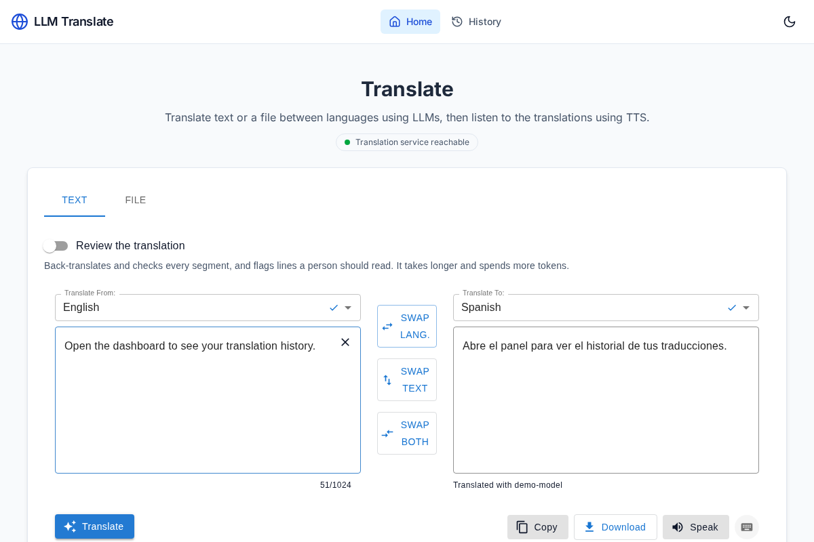

# Case Study: LLM Translate — a full-stack translation tool with measured quality

*A portfolio case study. The screenshots and numbers below come from the public repository at [github.com/samestrin/llm-translate](https://github.com/samestrin/llm-translate).*

## The problem

Machine translation demos are easy to find and easy to dismiss: a text box, an API call, a translated string. Real translation work is harder. A team localising a product needs whole files translated — JSON locale files, Markdown docs, SRT subtitles — with placeholders like `{name}` and file structure intact. It needs terminology kept consistent ("Dashboard" must come out as "Panel", "LLM Translate" must never be translated at all), and a tone that matches the audience. And it needs to know which segments a human still has to read, because no model is trusted blindly.

The goal: build a translation tool that does all of that, runs from a single `docker compose up`, works against any OpenAI-compatible endpoint (OpenAI, Groq, OpenRouter, or a local model), and — critically for a portfolio piece — ships with honest, reproducible quality numbers instead of adjectives.

## The approach

**Full-stack, boring where it should be.** A FastAPI backend in Python, a React/Vite frontend, both containerised. The API is versioned (`/v1/translate`, `/v1/translate/file`, `/v1/speak`) with interactive docs at `/docs`. Determinism by default: every model call runs at temperature 0, and an optional LRU cache keyed on the full request returns repeated translations without spending tokens.

**Files are first-class.** The hardest part is not the model call; it is what surrounds it. Each supported format (JSON, YAML, PO, Markdown, HTML, SRT) has a parser that splits the file into segments and puts translations back without touching structure: YAML comments, anchors and quoting survive; PO plural forms and fuzzy flags survive; Markdown code blocks and HTML attributes come back byte for byte. Placeholders are masked before the model sees the text and checked afterwards — a segment that loses one fails the request rather than shipping a broken file.

**Quality steering is a prompt problem, so make it explicit.** Callers pass a glossary (including do-not-translate terms) and a style guide (tone, formality, audience, notes); both go into the prompt, and the response reports which applicable glossary terms the translation *missed* — a report, never an error, so the caller decides.

**Trust but verify: a review pass.** With `review=on`, every segment is back-translated, then a reasoning model compares source, translation and back-translation and reports errors by category and severity. Segments with major or critical errors get one revision and a second review; anything still suspect is flagged with its severity, source and translation. Review is advice for a human, not a gate — and the report shows exactly what it cost in tokens per step.

**Measure it, don't assert it.** The repo carries an eval set (app strings, a Markdown page and an SRT file per language, each with a human reference translation, all sources and licenses documented) and a runner that scores chrF, placeholder integrity, glossary hits and review flag rate. The results file is committed; the README's eval table is tested against it, so the numbers on the front page cannot drift from the data.

**Shippable.** A release workflow builds both Docker images on every pull request as a dry run, and publishes to GHCR only when a `v*` tag matches the package version. The screenshot in the README is captured by a Playwright script against a fake OpenAI server — reproducible by anyone, with no API key ever on screen.

## The results

The committed eval run (`evals/results/2026-11-05.json`, model `deepseek-v4.1-flash`) across Spanish, French, Japanese and Brazilian Portuguese:

| Language | Review | chrF | Placeholders | Glossary | Flag rate |
|---|---|---|---|---|---|
| es | off | 81.6 | 100% | 3/3 | n/a |
| es | on | 80.8 | 100% | 3/3 | 0% |
| fr | off | 79.0 | 100% | 3/3 | n/a |
| fr | on | 78.8 | 100% | 2/3 | 0% |
| ja | off | 72.1 | 100% | 3/3 | n/a |
| ja | on | 70.8 | 100% | 3/3 | 1% |
| pt-BR | off | 82.4 | 100% | 3/3 | n/a |
| pt-BR | on | 83.0 | 100% | 3/3 | 0% |

What the numbers show:

* **Placeholder integrity is 100% in every configuration** — the masking and per-segment validation hold across all four languages, including Japanese, where the script and sentence structure share nothing with English.
* **The review pass is cheap in flags and honest in cost.** One flag in 403 segments with review on, and the token columns (review on runs 4–6x the tokens of review off) say exactly what the extra confidence costs. The one Japanese flag is the point of the feature: it is the segment a human should read first.
* **chrF in the 70s–80s** against human references is a solid result for a general-purpose model with no fine-tuning, and the review-on runs score within a point of review-off — the verification layer costs tokens, not quality.

The caveat is printed next to the table in the README: these are numbers for one model on a small set. They prove the pipeline protects structure and terminology, not that any language is perfect — and `evals/run.py` lets anyone rerun the measurement against their own endpoint and model.

## What I'd do next

A larger eval set with more languages and domains; a human-rated sample to calibrate the review pass's precision; and translation memory, so repeated strings across files are translated once and consistently.
